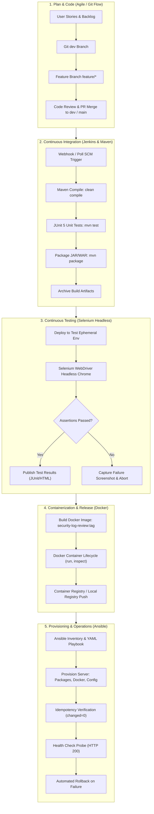

# Agile Planning and DevOps Workflow Specification
**Project:** Ansible-Provisioned Security Log Review System  
**Document Version:** 1.0.0  
**Status:** Approved Agile Baseline  
**Date:** October 2026  
**Artifact ID:** `deliverables/task-02/Agile_Planning_and_Workflow.md`

---

## 1. Executive Summary
This document establishes the Agile methodology, backlog structure, sprint schedule, user story specifications, Definition of Done (DoD), and end-to-end DevOps lifecycle architecture for the **Ansible-Provisioned Security Log Review System**. By bridging Agile product management with automated DevOps workflows, this plan ensures continuous integration, test-driven validation, containerized packaging, and idempotent infrastructure configuration.

---

## 2. Epics and Theme Hierarchy

```
┌────────────────────────────────────────────────────────────────────────┐
│             EPIC 1: Security Log Intake & Management (CRUD)            │
├────────────────────────────────────────────────────────────────────────┤
│             EPIC 2: Role-Based Workflow & Incident Escalation          │
├────────────────────────────────────────────────────────────────────────┤
│             EPIC 3: Executive Metrics Dashboard & Search Engine        │
├────────────────────────────────────────────────────────────────────────┤
│             EPIC 4: Automated CI/CD Pipeline & Quality Gates           │
├────────────────────────────────────────────────────────────────────────┤
│             EPIC 5: Containerization & Ansible Infrastructure as Code  │
└────────────────────────────────────────────────────────────────────────┘
```

---

## 3. User Stories and Acceptance Criteria (Gherkin Format)

### US-01: Ingest and Create Security Log Record
* **As a:** SOC Analyst / SysAdmin
* **I want to:** Submit a new security log entry with source IP, event type, severity, and payload message
* **So that:** Suspicious network or application events are formally captured in the central repository.
* **Acceptance Criteria (Given-When-Then):**
  - **Scenario 1 - Valid Submission:**
    - **Given:** The user navigates to the "New Log Entry" page.
    - **When:** The user enters Source IP `192.168.1.105`, Event Type `UNAUTHORIZED_ACCESS`, Severity `HIGH`, and a descriptive message, then submits the form.
    - **Then:** The record is saved in the database with status `NEW`, created timestamp set to current time, and redirected to the log list with a success toast.
  - **Scenario 2 - Validation Guardrail:**
    - **Given:** The user attempts to submit an empty form.
    - **When:** The form is submitted with null or blank mandatory fields.
    - **Then:** Client and server-side validation blocks submission with clear error messages.

---

### US-02: View, Inspect, and Search Security Logs
* **As a:** SOC Analyst
* **I want to:** View an indexed list of security logs and execute real-time searches across severity and keywords
* **So that:** I can quickly isolate security events without scanning thousands of unindexed lines.
* **Acceptance Criteria:**
  - **Given:** 50 security log records exist across various severities (`CRITICAL`, `HIGH`, `MEDIUM`, `LOW`).
  - **When:** The user searches for keyword `BRUTE_FORCE` or filters by severity `CRITICAL`.
  - **Then:** Only records matching the criteria are rendered dynamically in the log table.

---

### US-03: Role-Based Status Workflow Engine
* **As a:** SOC Lead / Incident Responder
* **I want to:** Transition a log status through defined state gates: `NEW` ➔ `IN_REVIEW` ➔ `ESCALATED` or `RESOLVED`
* **So that:** Audit compliance is maintained and incident ownership is clearly established.
* **Acceptance Criteria:**
  - **Given:** A log record is in `NEW` status.
  - **When:** An analyst begins investigation and updates the status to `IN_REVIEW` with reviewer notes.
  - **Then:** The system persists the status change, records the reviewer timestamp, and updates the UI badge.
  - **Scenario 2 - Escalation / Resolution:**
    - **Given:** A log record is in `IN_REVIEW` status.
    - **When:** The analyst marks it as `ESCALATED` or `RESOLVED`.
    - **Then:** The record state transitions accordingly and cannot regress to invalid prior states.

---

### US-04: Executive Summary & SOC Posture Dashboard
* **As a:** CISO / SOC Manager
* **I want to:** View aggregate statistics including total logs, pending reviews, active escalations, and severity distributions
* **So that:** I can assess immediate operational security risks at a glance.
* **Acceptance Criteria:**
  - **Given:** Multiple logs with varying statuses and severities exist.
  - **When:** The user accesses the dashboard root `/`.
  - **Then:** 4 metric cards (Total Logs, Critical/High Alerts, In Review, Resolved) display real-time calculated counts.

---

### US-05: Headless Selenium Automated Acceptance Testing
* **As a:** QA / DevOps Engineer
* **I want to:** Execute automated browser-driven Selenium tests on critical user paths with failure screenshot capture
* **So that:** Regressions in UI functionality, status workflows, and form validation are caught before deployment.
* **Acceptance Criteria:**
  - **Given:** The application is running locally or in a staging test container.
  - **When:** Maven executes `mvn test` targeting Selenium test classes in headless Chrome.
  - **Then:** All user journeys pass; if any assertion fails, an automated screenshot is saved under `target/screenshots/`.

---

### US-06: Continuous Integration & Pipeline as Code
* **As a:** DevOps Engineer
* **I want to:** Define a declarative `Jenkinsfile` orchestrating checkout, compilation, unit testing, Selenium testing, and packaging
* **So that:** Every code push is continuously built and validated against quality gates.
* **Acceptance Criteria:**
  - **Given:** A commit is pushed to the repository.
  - **When:** Jenkins detects the commit or scheduled poll triggers.
  - **Then:** Jenkins runs the pipeline stages (`Checkout` ➔ `Build` ➔ `Test` ➔ `Package` ➔ `Deploy`) and archives the resulting artifact.

---

### US-07: Docker Containerization & Lifecycle Control
* **As a:** Platform Engineer
* **I want to:** Package the application into a lightweight, isolated Docker container
* **So that:** The application runs predictably across developer, CI, and server environments.
* **Acceptance Criteria:**
  - **Given:** The packaged JAR file is compiled.
  - **When:** `docker build -t security-log-review:1.0.0 .` is run.
  - **Then:** The image is built successfully, exposes port `8080`, and responds with HTTP 200 on health check.

---

### US-08: Ansible Idempotent Infrastructure Provisioning
* **As a:** Infrastructure / Site Reliability Engineer (SRE)
* **I want to:** Provision the host server, install dependencies, and deploy the application container using Ansible playbooks
* **So that:** Environment configuration is fully automated, repeatable, and immune to configuration drift.
* **Acceptance Criteria:**
  - **Given:** A target host server with SSH access.
  - **When:** `ansible-playbook -i ansible/inventory.ini ansible/playbook.yml` is executed.
  - **Then:** The system packages, directories, and container are provisioned.
  - **Scenario 2 - Idempotency Validation:**
    - **When:** The exact same playbook is re-executed immediately.
    - **Then:** Output reports `changed=0`, proving no unnecessary state mutations occurred.

---

## 4. Product Backlog and Story Point Estimation

We utilize the Fibonacci scale (1, 2, 3, 5, 8, 13) to represent relative complexity, risk, and effort:

| Item ID | User Story / Task Description | Epic | Priority | Story Points | Target Milestone |
| :--- | :--- | :--- | :--- | :--- | :--- |
| **PB-01** | Problem Statement & Frozen Scope Definition | Governance | Critical | 2 | Task 1 |
| **PB-02** | Agile Planning, Backlog & DevOps Lifecycle | Planning | High | 3 | Task 2 |
| **PB-03** | System Architecture, Schema & Maven Project Setup | Architecture | Critical | 5 | Task 3 |
| **PB-04** | Git/GitHub Repository Init, Branch Policy & Templates | SCM | High | 3 | Task 4 |
| **PB-05** | Core Log CRUD Workflow on Feature Branch | Development | Critical | 8 | Task 5 |
| **PB-06** | Status Workflow, Dashboard & Merge Conflict Resolution | Development | Critical | 8 | Task 6 |
| **PB-07** | Jenkins CI Server Setup & Maven Freestyle Job | CI/CD | High | 5 | Task 7 |
| **PB-08** | Declarative Jenkinsfile & Web Deployment | CI/CD | High | 8 | Task 8 |
| **PB-09** | Selenium WebDriver UI Test Suite with Screenshot Capture | QA | Critical | 8 | Task 9 |
| **PB-10** | Continuous Testing Gate in Jenkins with Defect Injection | QA/CI | High | 5 | Task 10 |
| **PB-11** | Dockerfile Creation & Container Lifecycle Operations | Platform | High | 5 | Task 11 |
| **PB-12** | Jenkins-Docker Automated Continuous Delivery Pipeline | CD | High | 8 | Task 12 |
| **PB-13** | Ansible Playbook & Server Infrastructure Configuration | IaC | Critical | 8 | Task 13 |
| **PB-14** | Automated Provisioning, Idempotency & Rollback Drill | SRE | Critical | 8 | Task 14 |
| **PB-15** | Comprehensive Verification Dossier & Final Audit | Review | Medium | 3 | Task 15 |
| **TOTAL**| **Complete 15-Task Program** | | | **87 pts** | |

---

## 5. Sprint Schedule & 15-Task Kanban Work Breakdown

```
┌────────────────────────────────────────────────────────────────────────────────────────┐
│ SPRINT 1: INCEPTION & FOUNDATION (Tasks 1 to 4)                                        │
│ • Task 1: Problem Definition & Scope Specification                                     │
│ • Task 2: Agile Planning & DevOps Lifecycle Design                                     │
│ • Task 3: Architecture, Domain Model & Maven Foundation                                │
│ • Task 4: Git Repository, Branch Rules & Skeleton Initialization                       │
├────────────────────────────────────────────────────────────────────────────────────────┤
│ SPRINT 2: CORE DEVELOPMENT & COLLABORATIVE MVP (Tasks 5 to 6)                          │
│ • Task 5: Feature Branch 1 - Core Log CRUD Engine & Pull Request                       │
│ • Task 6: Feature Branch 2 - Status Engine, Dashboard & Conflict Resolution (v1.0.0)   │
├────────────────────────────────────────────────────────────────────────────────────────┤
│ SPRINT 3: CONTINUOUS INTEGRATION & AUTOMATED TESTING (Tasks 7 to 10)                   │
│ • Task 7: Jenkins Installation & Automated Build Job                                   │
│ • Task 8: Declarative Jenkinsfile Pipeline & Local Deployment                          │
│ • Task 9: Selenium WebDriver E2E Automation Suite with Failure Diagnostics             │
│ • Task 10: Jenkins Automated Quality Gate & Defect Recovery Verification               │
├────────────────────────────────────────────────────────────────────────────────────────┤
│ SPRINT 4: CONTAINERIZATION & ANSIBLE INFRASTRUCTURE AS CODE (Tasks 11 to 14)           │
│ • Task 11: Docker Containerization & Lifecycle Verification                            │
│ • Task 12: Continuous Delivery: Pipeline-to-Container Automation                       │
│ • Task 13: Ansible Configuration Management Playbook & Inventory                       │
│ • Task 14: Automated Provisioning, Idempotency Proof (`changed=0`) & Rollback Drill    │
└────────────────────────────────────────────────────────────────────────────────────────┘
```

---

## 6. Definition of Ready (DoR) and Definition of Done (DoD)

### 6.1 Definition of Ready (DoR)
A backlog task is marked **Ready** for implementation only when:
1. The user story is clearly defined with business value articulated.
2. Acceptance criteria are written in unambiguous Given-When-Then format.
3. Pre-task software tools are confirmed installed with verifiable CLI version output.
4. Architectural dependencies and target directories are documented.
5. Story point estimation is agreed upon.

### 6.2 Definition of Done (DoD)
A task is marked **Done** and signed off at the Checkpoint Gate only when:
1. Working code or configuration scripts fulfill all acceptance criteria.
2. Deliverable markdown documentation and command logs are saved in `deliverables/task-XX/`.
3. Terminal commands confirm successful execution (zero non-zero exit codes unless testing failure scenarios).
4. Code passes formatting and static analysis standards.
5. Explicit user checkpoint sign-off is recorded.

---

## 7. End-to-End DevOps Lifecycle Architecture Diagram

### 7.1 Mermaid Flowchart Architecture



### 7.2 ASCII DevOps Lifecycle Workflow

```
+---------------------------------------------------------------------------------------------------+
|                              END-TO-END DEVOPS LIFECYCLE WORKFLOW                                 |
+---------------------------------------------------------------------------------------------------+
  [DEVELOPER] 
      │ 
      ├─► (1) Feature Branch: git checkout -b feature/core-log-crud dev
      ├─► (2) Code & Local Test: Java 17 + Spring Boot 3 + Maven
      ├─► (3) Pull Request & Review: GitHub PR -> Merge into dev / main
      │
      ▼
  [CONTINUOUS INTEGRATION (JENKINS)]
      │
      ├─► (4) Trigger: Git Webhook / Polling (H/5 * * * *)
      ├─► (5) Build: mvn clean compile
      ├─► (6) Unit Test: mvn test (JUnit 5)
      ├─► (7) Package: mvn package -> security-log-review.jar
      │
      ▼
  [CONTINUOUS TESTING (SELENIUM WEBDRIVER)]
      │
      ├─► (8) Automated UI Tests: Headless Chrome WebDriver
      ├─► (9) Diagnostic Quality Gate: Pass ➔ Proceed | Fail ➔ Capture Screenshot & Abort
      │
      ▼
  [CONTAINERIZATION (DOCKER)]
      │
      ├─► (10) Build Image: docker build -t security-log-review:1.0.0 .
      ├─► (11) Image Validation: docker run, logs inspection, port mapping (8080:8080)
      ├─► (12) Image Delivery: Local Registry / Docker Hub Tagging
      │
      ▼
  [CONFIGURATION MANAGEMENT & DEPLOYMENT (ANSIBLE)]
      │
      ├─► (13) Target Server Configuration: ansible-playbook -i inventory.ini playbook.yml
      ├─► (14) Idempotency Verification: Re-run playbook -> verify changed=0
      ├─► (15) Live Verification & Rollback: HTTP Health Probe -> Automated Safe Fallback
+---------------------------------------------------------------------------------------------------+
```

---

## 8. Summary & Next Steps
With the Agile Backlog, User Stories, Scrum Plan, DoD, and DevOps Architecture finalized and locked, the system is primed for **Task 3: Requirements, Architecture and Technology Setup**.
