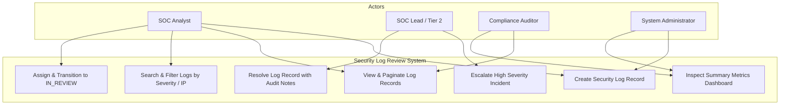
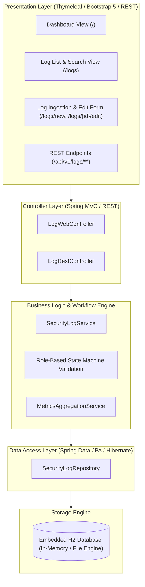
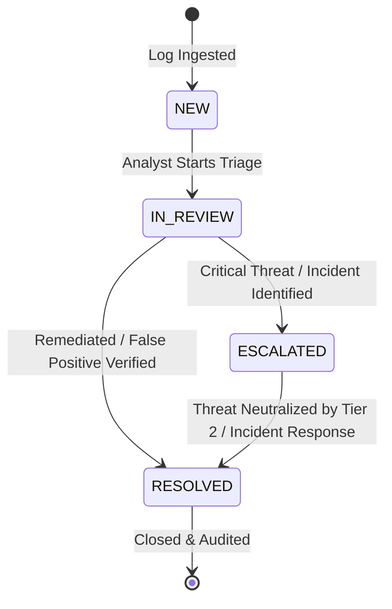
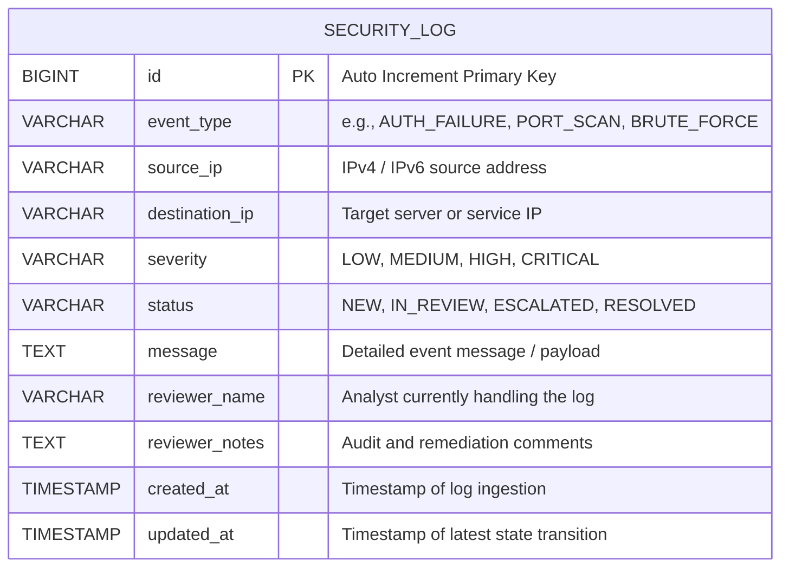

# System Architecture, Database Schema, and Technology Setup Specification
**Project:** Ansible-Provisioned Security Log Review System  
**Document Version:** 1.0.0  
**Status:** Approved Technical Architecture Baseline  
**Date:** October 2026  
**Artifact ID:** `deliverables/task-03/Architecture_and_Tech_Setup.md`

---

## 1. Executive Summary & SRS Summary
This document defines the technical architecture, data model, technology stack selection, and build configuration for the **Ansible-Provisioned Security Log Review System**. The system serves as an auditable operational platform for Security Operations Center (SOC) teams, system administrators, and security auditors to capture, triage, escalate, and resolve security events across enterprise infrastructure.

### System Requirements Specification (SRS) Summary
1. **Log Record Ingestion & Management:** The system must record security events with attributes including Event Type, Source IP, Destination IP, Severity (`LOW`, `MEDIUM`, `HIGH`, `CRITICAL`), descriptive payload, and timestamps.
2. **Deterministic Role-Based State Workflow:** Every ingested record initializes in `NEW` state and advances through governed transitions:
   - `NEW` ➔ `IN_REVIEW` (when an analyst begins investigation).
   - `IN_REVIEW` ➔ `ESCALATED` (for Tier 2 incident response or senior management intervention).
   - `IN_REVIEW` ➔ `RESOLVED` (upon mitigation or false positive determination).
   - `ESCALATED` ➔ `RESOLVED` (following resolution of high-severity incidents).
   - Backward transitions to `NEW` are strictly prohibited to preserve audit integrity.
3. **Multi-Parameter Search & Filtering:** Instant filtering of records by keyword matching (event type, IP, payload) and severity levels.
4. **Real-Time SOC Dashboard:** Aggregated operational metrics presenting Total Logs, Critical/High Alerts, Active Reviews, and Resolved Incidents.
5. **Zero-Configuration Portability:** Embedded in-memory / file-persisted H2 database requiring zero external database server setup.

---

## 2. Environment Verification & Prerequisite Proof

The local environment has been verified and configured with Java 17 LTS and Apache Maven 3.9.9:

### 2.1 Java 17 Version Verification
```powershell
PS D:\ASSIGNMENTS\DEVOPS\DEVOPS PROJECT> & 'C:\Program Files\Java\jdk-17\bin\java.exe' -version
java version "17.0.12" 2024-07-16 LTS
Java(TM) SE Runtime Environment (build 17.0.12+8-LTS-286)
Java HotSpot(TM) 64-Bit Server VM (build 17.0.12+8-LTS-286, mixed mode, sharing)
```

### 2.2 Apache Maven 3.9.9 Verification
```powershell
PS D:\ASSIGNMENTS\DEVOPS\DEVOPS PROJECT> .\mvn.cmd -version
Apache Maven 3.9.9 (8e8579a9e76f7d015ee5ec7bfcdc97d260186937)
Maven home: D:\ASSIGNMENTS\DEVOPS\DEVOPS PROJECT\tools\apache-maven-3.9.9
Java version: 17.0.12, vendor: Oracle Corporation, runtime: C:\Program Files\Java\jdk-17
Default locale: en_IN, platform encoding: Cp1252
OS name: "windows 11", version: "10.0", arch: "amd64", family: "windows"
```

---

## 3. Use-Case Diagram



---

## 4. Layered Application Architecture

The system follows a clean 3-Tier Layered Architecture with clear separation of concerns:



---

## 5. Role-Based Status State Machine



### State Machine Transition Rules
1. **Initial State:** All new entries enter the system in `NEW` state.
2. **Transition `NEW` ➔ `IN_REVIEW`:** Requires assigned analyst name.
3. **Transition `IN_REVIEW` ➔ `ESCALATED`:** Requires escalation reason in reviewer notes.
4. **Transition `IN_REVIEW` ➔ `RESOLVED`:** Requires resolution summary.
5. **Transition `ESCALATED` ➔ `RESOLVED`:** Permitted only after mitigation confirmation.
6. **Forbidden Transitions:** `RESOLVED` cannot transition back to `NEW` or `IN_REVIEW` without formal re-opening procedures.

---

## 6. Data Model and Database Schema

### 6.1 Entity-Relationship Diagram



### 6.2 Relational DDL (Data Definition Language)
```sql
CREATE TABLE security_logs (
    id BIGINT GENERATED BY DEFAULT AS IDENTITY PRIMARY KEY,
    event_type VARCHAR(100) NOT NULL,
    source_ip VARCHAR(45) NOT NULL,
    destination_ip VARCHAR(45),
    severity VARCHAR(20) NOT NULL,
    status VARCHAR(20) NOT NULL,
    message VARCHAR(2000) NOT NULL,
    reviewer_name VARCHAR(100),
    reviewer_notes VARCHAR(2000),
    created_at TIMESTAMP NOT NULL,
    updated_at TIMESTAMP NOT NULL
);

CREATE INDEX idx_logs_status ON security_logs(status);
CREATE INDEX idx_logs_severity ON security_logs(severity);
CREATE INDEX idx_logs_source_ip ON security_logs(source_ip);
```

---

## 7. REST API Endpoints Specification

| Method | Endpoint | Request Body | Description | Response Code |
| :--- | :--- | :--- | :--- | :--- |
| `GET` | `/api/v1/logs` | None | Retrieve all logs (supports query filters) | `200 OK` |
| `GET` | `/api/v1/logs/{id}` | None | Retrieve specific log by ID | `200 OK` / `404 Not Found` |
| `POST` | `/api/v1/logs` | `SecurityLogDTO` | Create and ingest a new log record | `201 Created` / `400 Bad Request` |
| `PUT` | `/api/v1/logs/{id}` | `SecurityLogDTO` | Update log details | `200 OK` / `404 Not Found` |
| `PATCH` | `/api/v1/logs/{id}/status` | `StatusTransitionDTO` | Advance status (`IN_REVIEW`, `ESCALATED`, `RESOLVED`) | `200 OK` / `400 Bad Request` |
| `GET` | `/api/v1/logs/metrics` | None | Retrieve aggregate dashboard metrics | `200 OK` |
| `DELETE` | `/api/v1/logs/{id}` | None | Delete log record (admin only) | `204 No Content` |

---

## 8. Technology Stack Selection Rationale

| Component | Selected Technology | Rationale & Justification |
| :--- | :--- | :--- |
| **Language & Platform** | Java 17 LTS | Enterprise long-term support, memory efficiency, pattern matching, records, and strong typing. |
| **Framework** | Spring Boot 3.2.x | Rapid production-grade microservice framework with built-in metrics (Actuator), validation, and embedded Tomcat. |
| **UI Engine** | Thymeleaf 3 + Bootstrap 5 | Server-rendered templates avoiding complex Node.js build pipelines while providing explicit DOM IDs for Selenium automation. |
| **Database** | Embedded H2 Database | Zero-dependency, zero-install database engine running seamlessly in memory or local file across dev workstations, CI runners, and Docker containers. |
| **Build & Dependency Tool** | Apache Maven 3.9+ | Predictable, declarative dependency management and lifecycle hooks standard in enterprise Java ecosystems. |
| **Testing** | JUnit 5 + Selenium WebDriver 4 | Dual-layer testing: unit/integration testing with Mockito + full browser user-journey acceptance tests with automated screenshot capture. |
| **CI/CD** | Jenkins LTS | Industry-standard declarative pipeline automation for build, test, packaging, and deployment stages. |
| **Containerization** | Docker Engine | Lightweight, immutable packaging ensuring application consistency across all environments. |
| **Configuration Management** | Ansible Core | Agentless, idempotent infrastructure automation verifying zero configuration drift (`changed=0`). |

---

## 9. Baseline `pom.xml` Skeleton
The initial Maven `pom.xml` has been created in the workspace root configuring:
- `spring-boot-starter-web`
- `spring-boot-starter-thymeleaf`
- `spring-boot-starter-data-jpa`
- `spring-boot-starter-validation`
- `spring-boot-starter-actuator`
- `com.h2database:h2` (runtime)
- `spring-boot-starter-test` (test)
- `org.seleniumhq.selenium:selenium-java` (test)
- `spring-boot-maven-plugin` & `maven-surefire-plugin`
